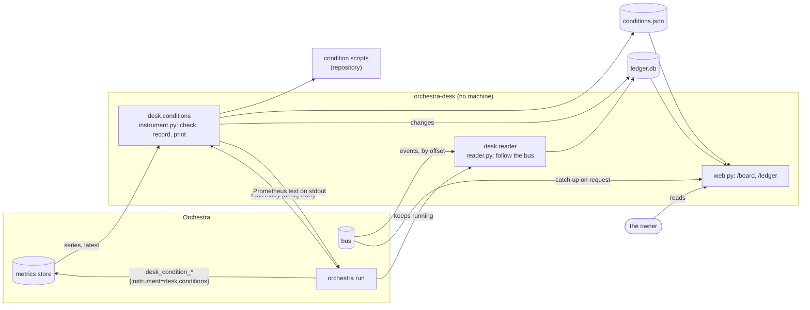
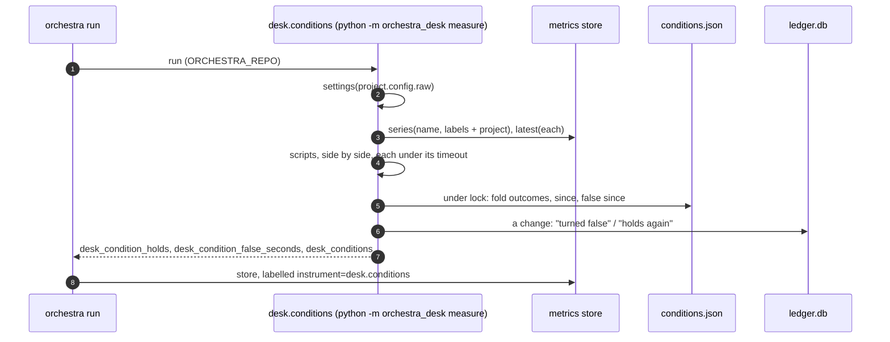

# orchestra-desk: architecture

How the Desk is built. `SPEC.md` is the design; this is the map of the code.

## 1. The picture

Nothing points from the Desk to the bus, and only `orchestra run` writes the store.

## 2. Modules

| Module | What |
|---|---|
| `__init__.py` | the names: plugin `desk`, state directory `desk` |
| `config.py` | `[desk]`: conditions, readings, ledger rules, checked key by key (`problems`, `settings`) |
| `language.py` | comparisons and expressions (`ast`, walked, never `eval`) |
| `readings.py` | a reading from the store: this project's series, fresh points, reduced |
| `scripts.py` | a script condition: run, time out, parse the first line and the reason |
| `conditions.py` | one round's outcomes (holds, false, unknown) with evidence; scripts side by side |
| `record.py` | `conditions.json`: outcomes over time, since, false since; changes as ledger entries |
| `instrument.py` | the instrument: a round, and its Prometheus text |
| `board.py` | ranking for the board |
| `rules.py` | the ledger's rules: built-in, templates, safe links |
| `ledger.py` | `ledger.db` (SQLite): entries, offset, rules' fingerprint |
| `reader.py` | `catch_up` and the `desk.reader` process |
| `check.py`, `cli.py` | `orchestra desk check`, and `measure` / `read` for `orchestra run` |
| `plugin.py` | the entry point: two pages, the router, the process and the instrument when configured |
| `web.py` | the pages' API (read only) |
| `static/` | `desk.html` + `board.js`, `ledger.html` + `ledger.js`, `desk.css` (linked by its own pages only) |

## 3. One round of the instrument

## 4. Decisions, and why

- **An instrument, not a process, checks the conditions**: a condition is a measurement (Orchestra's
  rule 7, story placement §2.4), and a command instrument needs no port (as the task system's
  `tasks.tickets`). Each round is a fresh process, so the record keeps what must last between rounds.
- **The board reads the record; it does not check**: one place checks, so "since" and "false since"
  have one author, and the web server never runs the owner's scripts.
- **A reader process and a reader in the web server**: the process keeps the ledger complete while
  `orchestra run` runs (a bus with retention would otherwise lose what nobody looked at); the web
  server's pass makes the page current without it. Ids make two readers safe.
- **A change of rules reads the bus again**: the ledger is a view of the bus, and a new rule should
  apply to the past. Entries are kept by id; nothing is deleted.
- **SQLite for the ledger, JSON for the record**: the ledger has three writers and filters by time
  and kind; the record has one writer, under a lock, and is small.
- **No every-page script or card**: the Desk has no machine to draw, and its pages link its CSS
  themselves, so nothing restyles another page.

## 5. Tests

| File | What |
|---|---|
| `tests/unit/test_conditions.py` | a series condition turns false and true, the instrument reports it, changes reach the ledger; unknown keeps "false since"; labels, reduce, this project only; expressions; missing readings; script reasons, errors and timeouts on the board; no reason in a metric |
| `tests/unit/test_language.py` | comparisons, expressions, and what they refuse |
| `tests/unit/test_board.py` | the ranking; not checked yet; not configured, broken |
| `tests/unit/test_ledger.py` | landings, merges, reviews, sends from a recorded bus; a restart and a lost offset double nothing; rules filter, relabel, replay; unsafe links dropped; the page's filters |
| `tests/unit/test_config_check.py` | every refusal, all at once; SPEC's example; the check CLI (exit codes, JSON, warnings, the store) |
| `tests/unit/test_plugin.py` | the declaration (no machine), Orchestra loading it, the pages, file modes |
| `tests/unit/test_not_a_machine.py` | a whole round publishes nothing and writes no metric; no module can |
| `tests/e2e/test_orchestra_run.py` | `orchestra run`: a condition over a project instrument turns false and true in the store; a landing reaches the ledger; nothing on the bus from the Desk; a restart doubles nothing |
